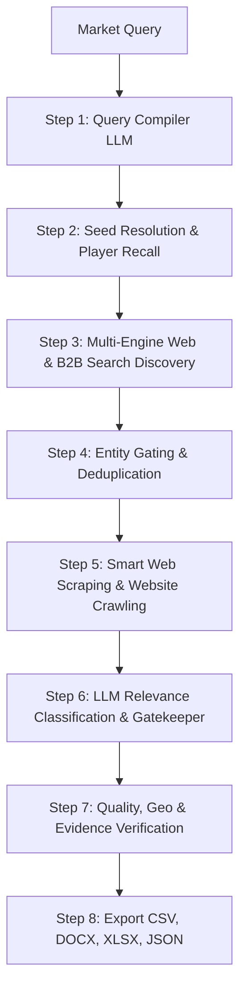
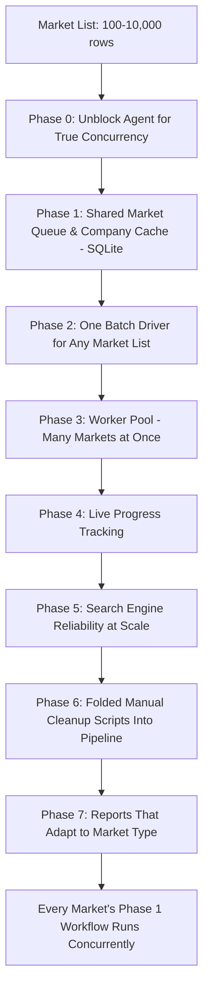

# Agent Workflow & 10,000-Market Scaling Report

This report explains, in two phases, how the Vendor Intelligence Agent works:

- **Phase 1** — how the agent processes **one market** end-to-end (already in place).
- **Phase 2** — the work done to take that same agent from running **one market at a time** to running **100–10,000 markets in a single unattended batch**.

---

## Phase 1: How the Agent Works for One Market

### Step 1: Market Query Compiler & Scope Extraction
* **Goal:** Turn a natural language query (e.g., *"Leading avocado oil manufacturers in Mexico"*) into a structured, executable query plan.
* **Actions:**
  1. **LLM Query Decomposition:** Passes the prompt to the LLM (`gpt-4o-mini` or open-source fallback).
  2. **Scope Extraction:** Extracts key parameters — `market` (target category), `geographies` (country/region filters), `search_topic` (optimized search keywords), `anchor_company` (competitor anchors if referenced).
  3. **Funnel Generation:** Generates multi-tiered search prompts across 3 levels — **L0** (broad industry landscape terms), **L1** (role-specific: manufacturer, supplier, OEM, distributor), **L2** (market leader / competitor queries).
  4. **Discovery Prompts:** Formulates up to 9 targeted search queries covering competitor angles and product variants.

### Step 2: Seed Resolution & Known-Player Recall
* **Goal:** Seed the candidate pipeline with high-confidence industry players.
* **Actions:**
  1. **Curated Seeds Lookup:** Matches market keywords against pre-configured seed lists.
  2. **LLM Knowledge Recall:** Asks the LLM for well-known global/regional players based on its trained knowledge.
  3. **Domain Resolution:** Resolves company names to official domain URLs via web search.
  4. **Seed Pinning:** Pins these seed companies so they're guaranteed candidates for enrichment and classification.

### Step 3: Multi-Source Web & B2B Directory Discovery
* **Goal:** Discover candidate company names and official domain URLs across search engines and directory platforms.
* **Actions:**
  1. **Free Search Engine Stack:** Executes search queries across multiple backends with rate limiting & circuit breakers — DuckDuckGo/DDGS aggregator (DDG, Bing, Brave, Mojeek, Google) → Bing direct HTML scraper → SearXNG (self-hosted meta-search) → Wikipedia (fallback).
  2. **B2B Directory & Profile Search:** Conducts targeted site-specific queries across 8 specialized platforms — B2B portals (Alibaba, Global Sources, Kompass, ThomasNet, TradeIndia, ImportYeti) and social/firmographic profiles (LinkedIn Company Pages, Owler Company Profiles).
  3. **Candidate Aggregation:** Collects titles, snippets, and links, parsing potential company candidate names and domains.

### Step 4: Entity Gating & Deduplication
* **Goal:** Filter out noise, non-company websites, blogs, marketplaces, and directories before scraping.
* **Actions:**
  1. **Domain Deduplication:** Normalizes URLs to root domains.
  2. **Directory & Marketplace Filtering:** Rejects non-company domains (e.g. Amazon, Wikipedia, Bloomberg, Yellow Pages).
  3. **Domain Corrections & Aliasing:** Fixes common domain redirection errors.
  4. **Off-Market Keyword Pre-filtering:** Discards obvious irrelevant hits based on negative keyword matches.

### Step 5: Web Scraping & Deep Website Enrichment
* **Goal:** Extract first-party firmographic and product evidence directly from each candidate company's official website.
* **Actions:**
  1. **Headless Browser Crawling:** Launches browser/HTTP fetchers with controlled concurrency to respect memory and site rate limits.
  2. **Target Page Navigation:** Discovers and scrapes key pages — Home, About Us, Products/Services, Contact Us, Company/Profile.
  3. **Firmographic Data Extraction:** Extracts on-page evidence for core products/services, headquarters/office locations, year founded & employee count, official contact info, and business model/channel indicators (B2B, OEM, wholesale, direct-to-consumer).

### Step 6: LLM Relevance Classification & Gatekeeper
* **Goal:** Evaluate scraped site content using an LLM classifier to determine market inclusion, company role, and evidence score.
* **Actions:**
  1. **LLM Evaluation Prompt:** Sends the candidate's scraped textual content alongside the market definition to the LLM.
  2. **Classification Outputs:** Relevance status (kept vs. rejected), company type/role (manufacturer, supplier/distributor, system integrator, retailer, service provider), plain-language inclusion reason, evidence URLs, and a numeric confidence score.

### Step 7: Quality, Geographic & Evidence Verification
* **Goal:** Ensure final export data meets strict accuracy and geographic constraints.
* **Actions:**
  1. **Geographic Filtering:** Verifies company headquarters match the requested geography (unless exempted as global seeds).
  2. **Quality Gate:** Filters out low-confidence or unsubstantiated entries.
  3. **Verification Split:** Separates the final list into a **Verified** set (confirmed with valid site evidence) and an **Unverified / Could Not Confirm** set (crawl failed or evidence was ambiguous), each with a stated reason.

### Step 8: Multi-Format Data Export
* **Goal:** Output clean, structured report artifacts for client consumption.
* **Actions:**
  1. **CSV Export:** Standard tabular export with firmographics, role, inclusion reasons, and source links.
  2. **DOCX Export:** CEO-ready formatted Word document report.
  3. **XLSX Export:** Schema-customized Excel spreadsheet adapted to market type (e.g. FMCG vs. general industrial).
  4. **JSON Export:** Complete raw dataset preserving the full audit trail.

### Data Source Summary

| Data Field | Primary Source | Extraction Method |
| :--- | :--- | :--- |
| Market Scope & Funnel Queries | LLM Knowledge Base | LLM prompting |
| Seed Company Names | Local Seed Files / LLM Memory | Keyword matching & LLM enumeration |
| Candidate URLs | DDG, Bing, Brave, SearXNG, B2B Sites | Multi-engine search routing |
| Firmographics (HQ, Products, Year) | Candidate's Official Website | Smart headless browser scraping |
| Relevance & Role Classification | Crawled Site Content | LLM evidence classification gate |
| Inclusion Proof & Reasoning | Scraped Text & Search Snippets | LLM text synthesis |

This is the proven, working part of the system — Phase 2 below is entirely about running many copies of this same workflow safely and efficiently at once.

---

## Phase 2: Scaling This Workflow to 10,000 Markets at a Time

Running Phase 1 once per market, one after another, does not survive real volume: no resumability, no shared search-engine throttling (so engines start blocking), no cross-market reuse of already-collected data, and no way to queue thousands of markets and walk away. This phase covers the 8 pieces of work (Phase 0 → Phase 7) built to solve that.

### Phase 0 — Unblock the Agent for True Concurrency
The classification and search calls were silently blocking each other, so running two markets "at once" was really running them one after another in disguise. Fixed so LLM and search calls run properly in parallel — the foundation everything else depends on.

### Phase 1 — Shared Market Queue & Company Cache
Added a lightweight local database (**SQLite**) that tracks every market's status (waiting / running / done / failed) and a cross-market company cache (a company already looked up for one market is reused instead of re-scraped for another).

**Why SQLite:** it needed to be a shared source of truth that many markets running at the same time can safely read and write to at once, survive a crash or restart without losing progress, and not require installing or managing a separate database server. SQLite is a single local file that supports exactly that kind of safe concurrent read/write (in "WAL mode"), so it was the simplest tool that met the requirement — no extra infrastructure to set up or maintain.

### Phase 2 — One Batch Driver for Any Market List
Replaced the old "one script per market" approach with a single driver: give it a list of markets (a CSV file — market name, country, market type) and it loads all of them and runs the same Phase 1 workflow for each, writing the same CSV/DOCX/XLSX/JSON outputs per market.

### Phase 3 — Worker Pool (Running Many Markets at Once)
Built the engine that pulls markets off the queue and runs several at the same time, safely — no two workers can ever grab the same market. Failures are automatically classified as "temporary" (retried) or "permanent" (parked for review), and per-market search/LLM load is automatically scaled down as more markets run concurrently so the system doesn't overload itself.

### Phase 4 — Live Progress Tracking
Added a simple status view you can check anytime while a batch is running: how many markets are pending/running/done/failed, companies found so far, and recent failures — without stopping the batch.

### Phase 5 — Search Engine Reliability at Scale
At 10,000 markets, free search engines will start rate-limiting or blocking. Added a shared throttle + "circuit breaker" — if one search engine starts blocking, the system automatically backs off or switches engines for every market, not just the one that got blocked. Also added result caching, so markets with overlapping/similar search queries don't repeat the same search twice.

### Phase 6 — Folded the Manual Cleanup Scripts Into the Pipeline
Previously, after a market finished, someone had to run a stack of manual scripts to catch missed companies and remove bad ones. That logic is now automatically part of every market's run — no separate manual step needed anymore.

### Phase 7 — Reports That Adapt to Market Type
The Excel report used to be hardcoded for one type of market (consumer goods). It now automatically picks the right column set depending on the market type (consumer goods vs. general industrial), so one batch of 10,000 mixed markets still produces the right report shape for each.

---

## How a 10,000-Market Batch Actually Runs

1. **Prepare the list** — one CSV file with every market (name, country, market type).
2. **Start the batch** — one command loads the list and starts working through it, running several markets at once.
3. **Monitor** — check live progress/failures anytime from a second window, without interrupting the run.
4. **If interrupted** — restarting with the same batch name resumes automatically from where it left off; nothing already done is repeated.
5. **Staged rollout** — validated at increasing scale before committing to the full run: a 1–2 market smoke test (confirms every step works), then ~50 markets (checks accuracy against known-good manual results and search reliability), then ~500 markets (same checks at 10x volume), and only then the full 10,000-market run.

This staged approach exists because search-engine block behavior and safe concurrency levels can only be measured by actually running it — not guessed in advance.
