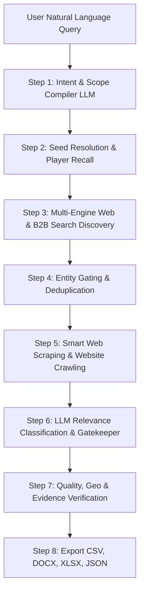

# Step-by-Step Guide: How the Agent Fetches Company & Market Data

This document provides a complete, step-by-step technical and operational breakdown of how the **Vendor Intelligence Agent** processes a natural language query, discovers target companies, scrapes their website data, validates their relevance, and exports verified firmographic data.

---

## 1. High-Level Agent Architecture Workflow



---

## 2. Detailed Step-by-Step Execution Flow

### Step 1: Market Query Compiler & Scope Extraction
* **Module:** `src/vendor_intel/stages/a_compiler.py` & `src/vendor_intel/phase1/runner.py`
* **Goal:** Turn a natural language query (e.g., *"Leading avocado oil manufacturers in Mexico"*) into a structured, executable query plan.
* **Actions:**
  1. **LLM Query Decomposition:** Passes the prompt to the LLM (`gpt-4o-mini` or open-source fallback).
  2. **Scope Extraction:** Extracts key parameters:
     * `market`: Target market category phrase.
     * `geographies`: Target country/region filters (e.g., `["Mexico"]` or `["Global"]`).
     * `search_topic`: Optimized search query keywords.
     * `anchor_company`: Competitor anchors if referenced in the prompt.
  3. **Funnel Generation:** Generates multi-tiered search prompts across 3 funnel levels:
     * **L0 (Broad Universe):** Industry landscape search terms.
     * **L1 (Role Specific):** Manufacturer, supplier, OEM, or distributor specific search terms.
     * **L2 (Leader/Competitor):** Market leader and top player search queries.
  4. **Discovery Prompts (P1–P9):** Formulates up to 9 targeted search queries covering competitor angles and product variants.

---

### Step 2: Seed Resolution & Known-Player Recall
* **Module:** `src/vendor_intel/pipeline/plan_seeds.py` & `src/vendor_intel/funnel/market_understanding.py`
* **Goal:** Seed the candidate pipeline with high-confidence industry players.
* **Actions:**
  1. **Curated Seeds Lookup:** Matches market keywords against pre-configured seed lists in `queries/seeds/*.txt`.
  2. **LLM Knowledge Recall (`enumerate_market_players`):** Asks LLM for well-known global/regional players based on its trained knowledge.
  3. **Domain Resolution:** Resolves company names to official domain URLs via web search.
  4. **Seed Pinning:** Pins these seed companies so they are guaranteed candidates for enrichment and classification.

---

### Step 3: Multi-Source Web & B2B Directory Discovery
* **Module:** `src/vendor_intel/phase2/discovery_fast.py` & `src/vendor_intel/pipeline/multi_source_discovery.py`
* **Goal:** Discover candidate company names and official domain URLs across search engines and directory platforms.
* **Actions:**
  1. **Free Search Engine Stack:** Executes search queries via `clients/search_router.py` across multiple search backends with rate limiting & circuit breakers:
     * **DuckDuckGo / DDGS Aggregator** (DDG, Bing, Brave, Mojeek, Google)
     * **Bing Direct HTML Scraper**
     * **SearXNG** (Self-hosted meta-search)
     * **Wikipedia** (Fallback)
  2. **B2B Directory & Profile Search:** Conducts targeted site queries (`site:...`) across 8 specialized platforms:
     * B2B Portals: *Alibaba, Global Sources, Kompass, ThomasNet, TradeIndia, ImportYeti*
     * Social / Firmographic Profiles: *LinkedIn Company Pages, Owler Company Profiles*
  3. **Candidate Aggregation:** Collects titles, snippets, and links, parsing potential company candidate names and domains.

---

### Step 4: Entity Gating & Deduplication
* **Module:** `src/vendor_intel/pipeline/entity_gate.py` & `src/vendor_intel/utils/domain_corrections.py`
* **Goal:** Filter out noise, non-company websites, blogs, marketplaces, and directories before scraping.
* **Actions:**
  1. **Domain Deduplication:** Normalizes URLs to root domains (e.g., `https://www.company.com/about` $\rightarrow$ `company.com`).
  2. **Directory & Marketplace Filtering:** Rejects non-company domains (e.g., `amazon.com`, `wikipedia.org`, `bloomberg.com`, `yellowpages.com`).
  3. **Domain Corrections & Aliasing:** Fixes common domain redirection errors.
  4. **Off-Market Keyword Pre-filtering:** Discards obvious irrelevant hits based on negative keyword matches.

---

### Step 5: Web Scraping & Deep Website Enrichment
* **Module:** `src/vendor_intel/enrichment/smart_enrichment.py` & `src/vendor_intel/crawler/smart_crawl.py`
* **Goal:** Extract first-party firmographic and product evidence directly from each candidate company's official website.
* **Actions:**
  1. **Headless Browser Crawling:** Launches Playwright / HTTP fetchers with controlled concurrency to respect memory and site rate limits.
  2. **Target Page Navigation:** Discovers and scrapes key pages: `Home`, `About Us`, `Products / Services`, `Contact Us`, `Company / Profile`.
  3. **Firmographic Data Extraction:** Extracts on-page textual evidence for:
     * Core Products & Services offered
     * Company Headquarters / Office Locations
     * Year Founded & Employee Count
     * Official Contact Info (Email, Phone)
     * Business Model / Channel Indicators (B2B, OEM, Wholesale, Direct-to-Consumer)

---

### Step 6: LLM Relevance Classification & Gatekeeper
* **Module:** `src/vendor_intel/intelligence/classifier.py`
* **Goal:** Evaluate scraped site content using an LLM classifier to determine market inclusion, company role, and evidence score.
* **Actions:**
  1. **LLM Evaluation Prompt:** Sends the candidate's scraped textual content alongside the market definition to the LLM.
  2. **Classification Outputs:**
     * **Relevance Status:** `Kept` vs. `Rejected`.
     * **Company Type / Role:** *Manufacturer, Supplier/Distributor, System Integrator, Retailer, Service Provider*.
     * **Inclusion Reason:** Plain-language justification of why the company qualifies for this market.
     * **Inclusion Sources & Evidence URLs:** Specific page links proving their market involvement.
     * **Confidence Score:** Numeric rating of certainty.

---

### Step 7: Quality, Geographic & Evidence Verification
* **Module:** `src/vendor_intel/pipeline/quality_export.py` & `src/vendor_intel/pipeline/geo_filter.py`
* **Goal:** Ensure final export data meets strict accuracy and geographic constraints.
* **Actions:**
  1. **Geographic Filtering:** Verifies that company headquarters match requested geographical bounds (unless exempted as global seeds).
  2. **Quality Gate:** Filters out low-confidence or unsubstantiated entries.
  3. **Verification Split:**
     * **Verified List:** Fully confirmed companies with valid site evidence and clear market fit.
     * **Unverified / Could Not Confirm:** Companies where web crawl failed or evidence was ambiguous.

---

### Step 8: Multi-Format Data Export
* **Module:** `src/vendor_intel/export/` & `src/vendor_intel/pipeline/orchestrator.py`
* **Goal:** Output clean, structured report artifacts for client consumption.
* **Actions:**
  1. **CSV Export (`company_list.csv`):** Standard tabular export containing firmographics, role, inclusion reasons, and source links.
  2. **DOCX Export:** CEO-ready formatted Word document report.
  3. **XLSX Export:** Schema-customized Excel spreadsheet adapted to market type (e.g., FMCG vs General Industrial).
  4. **JSON Export:** Complete raw dataset object preserving full audit trail.

---

## 3. Data Source Summary Table

| Data Field | Primary Source | Extraction Method |
| :--- | :--- | :--- |
| **Market Scope & Funnel Queries** | LLM Knowledge Base | LLM Prompting (`stages/a_compiler.py`) |
| **Seed Company Names** | Local Seed Files / LLM Memory | Keyword Matching & LLM Enumerate |
| **Candidate URLs** | DDG, Bing, Brave, SearXNG, B2B Sites | Multi-Engine Search Routing |
| **Firmographics (HQ, Products, Year)** | Candidate's Official Website | Smart Headless Browser Scraping |
| **Relevance & Role Classification** | Crawled Site Content | LLM Evidence Classification Gate |
| **Inclusion Proof & Reasoning** | Scraped Text & Search Snippets | LLM Text Synthesis |

---

## 4. How to Run the Agent

### A. Run a Single Market Search (CLI)
To execute the agent for one market query end-to-end:

```powershell
.venv\Scripts\python.exe run_cli.py --live "Leading avocado oil manufacturers in Mexico"
```

### B. Run Phase 1 Only (Plan & Search Verification)
To inspect the search queries and scope before scraping:

```powershell
.venv\Scripts\python.exe run_phase1.py --live "Leading avocado oil manufacturers in Mexico"
```

### C. Run Batch Agent Processing (Scaling across multiple markets)
To run the agent across hundreds or thousands of market queries concurrently:

```powershell
.venv\Scripts\python.exe run_batch.py --input queries/markets_sample.csv --batch-id batch-01 --max-concurrent 5
```

Check batch status in real time:
```powershell
.venv\Scripts\python.exe status_batch.py --batch-id batch-01 --watch
```
