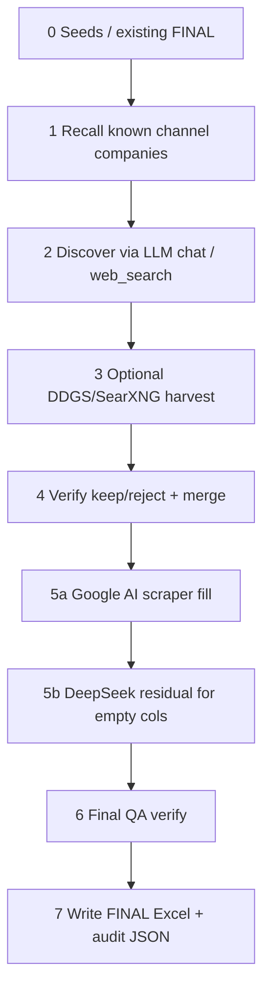

# ChatGPT Expand Pipeline

Full market expand via OpenAI-compatible SDK (**DeepSeek** or OpenAI).  
Does **not** use classic `run_query.py` / Phase-1 market map.

| Item | Path |
|------|------|
| Core | `src/vendor_intel/pipeline/chatgpt_expand.py` |
| Batch CLI | `run_chatgpt_expand_batch.py` |
| Step-5 fill | `src/vendor_intel/pipeline/search_stack_fill.py` |
| Checkpoint | `src/vendor_intel/pipeline/openai_expand_checkpoint.py` |
| Batch queue | `src/vendor_intel/batch/expand_orchestrator.py` + `data/batch.db` |
| Output | `output/web_expand/<market_slug>/` |

---

## Steps (0–7)



| Step | What | Checkpoint key |
|------|------|----------------|
| **0** | Load seeds + existing FINAL rows | `0_start` |
| **1** | Recall channel companies from LLM knowledge | `1_recall` |
| **2** | Discover more companies (DeepSeek chat or OpenAI `web_search`) | `2_discover` |
| **3** | Optional DDGS/SearXNG harvest + extract (often skipped) | `3_ddgs` |
| **4** | Verify market-related keep/reject; merge into landscape rows | `4_verify`, `4b_merge` |
| **5a** | Fill SLIM columns: **Google AI scraper first** (one ask per column) | `5_fill` (partial) |
| **5b** | DeepSeek residual only for leftover empty / NPD columns | `5_fill` |
| **6** | Final keep/reject QA on filled rows | `6_final` |
| **7** | Write wrap-formatted `*_FINAL.xlsx` + audit JSON | `status=done` |

Resume: finished steps are skipped via `chatgpt_checkpoint_batch_all.json` per market.  
Done markets in `batch.db` are skipped on the next batch run.

---

## Step 5 detail (Google AI)

When `--fill-backend search` (default for your runs):

1. For each company, ask Google AI once per missing column, e.g.  
   `founded year of "Acme"` · `operational presence of "Acme"` · …
2. Long Overview text → **DeepSeek clean** → useful sentences only.
3. Parse into columns (no invented emails/phones).
4. Contact Person / Role / LinkedIn = **sales or procurement only** (not CEO).
5. Remaining empties → DeepSeek residual (`SEARCH_STACK_OPENAI_RESIDUAL=true`).

Requires:

- Backend: `http://127.0.0.1:15551` (`google_ai_scraper --backend`)
- Chrome **Profile 5** extension connected (popup open)

---

## Excel columns (slim / avocado FINAL)

```
Company · Website · Founded · Headquarters · Continent / Geography ·
Operational Presence · Ownership · Employees · Core Categories ·
Specialty Focus · Key Brands Represented · Retail / E-commerce / Both ·
Distribution Type · Contact Person · Role · Email · LinkedIn ·
Office No. · Country Code · Region Code · Summary
```

---

## Batch CLI

```powershell
cd D:\vendor-intel
.\.venv\Scripts\python.exe run_chatgpt_expand_batch.py `
  --input queries\five_best_markets_1000.txt `
  --batch-id expand-5best-1000 `
  --target 1000 --max-fill 1000 --max-queries 400 `
  --max-concurrent 1 `
  --fill-backend search `
  --no-ddgs-harvest --no-apollo --yes
```

| Flag | Meaning |
|------|---------|
| `--batch-id` | SQLite queue id; reuse to resume |
| `--target` | Discovery target companies |
| `--max-fill` | Cap rows filled in step 5 |
| `--fill-backend search` | Google AI → residual |
| `--fill-backend openai` | LLM fill path (`gpt_fill_rows`) |
| `--no-ddgs-harvest` | Skip step 3 |
| `--no-apollo` | Skip Apollo after Google AI |
| `--fresh` | Redo markets (dangerous) |

---

## Important env vars

| Env | Role |
|-----|------|
| `OPENAI_BASE_URL` / `OPENAI_API_KEY` / `OPENAI_MODEL` | DeepSeek or OpenAI |
| `GOOGLE_AI_SCRAPER_ENABLED=true` | Enable scraper client |
| `GOOGLE_AI_SCRAPER_BASE_URL=http://127.0.0.1:15551` | Backend |
| `SEARCH_STACK_SOURCES=google_ai` | Step-5a sources |
| `GOOGLE_AI_GAP_FILL_MAX_QUERIES=22` | Asks per company |
| `GOOGLE_AI_SCRAPER_LLM_CLEAN=true` | DeepSeek cleans Overview |
| `GOOGLE_AI_SCRAPER_LLM_CLEAN_ONLY_WHEN_MISSING=false` | Always clean long Overview |
| `GOOGLE_AI_SCRAPER_LLM_MODEL=deepseek-chat` | Clean model |
| `EXPAND_FILL_CONCURRENT=1` | One company at a time (Chrome-safe) |
| `GAP_FILL_GOOGLE_AI_TIMEOUT_SEC=900` | Per-company Google AI budget |
| `SEARCH_STACK_OPENAI_RESIDUAL=true` | Step 5b DeepSeek residual |

---

## Artifacts per market

```
output/web_expand/<slug>/
  chatgpt_checkpoint_batch_all.json   ← resume state
  <slug>_FINAL.xlsx                   ← landscape Excel
  chatgpt_openai_discover_*.json
  chatgpt_rejected_mid_*.json
  chatgpt_rejected_final_*.json
  … audit / harvest JSON as enabled
```

Registry: `data/batch.db` → market `status` = `pending` | `running` | `done` | `failed`.

---

## Start Google AI scraper (before expand)

```powershell
cd D:\Coherent-Quadrant\google-ai-scraper-main\google-ai-scraper-main\server
.\.venv\Scripts\python.exe -m google_ai_scraper.mcp_server.server --backend --port 15551
```

Then open Chrome **Profile 5** → scraper extension popup → keep open.  
Health check: `http://127.0.0.1:15551/health` → `extension_connected: true`.
