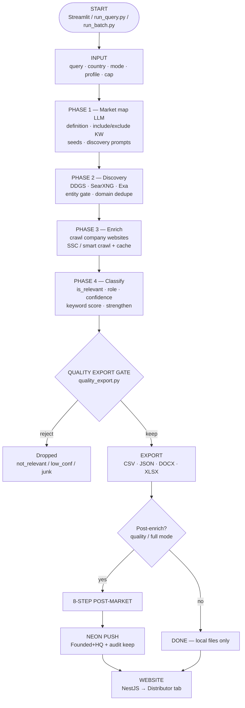
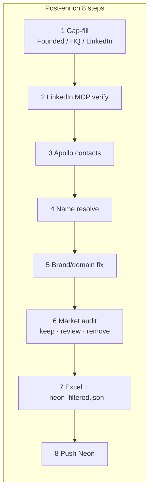
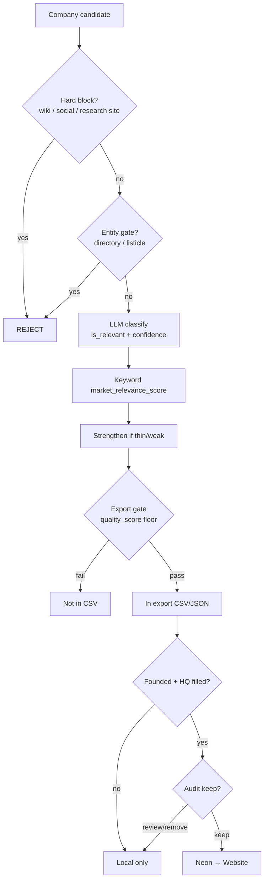
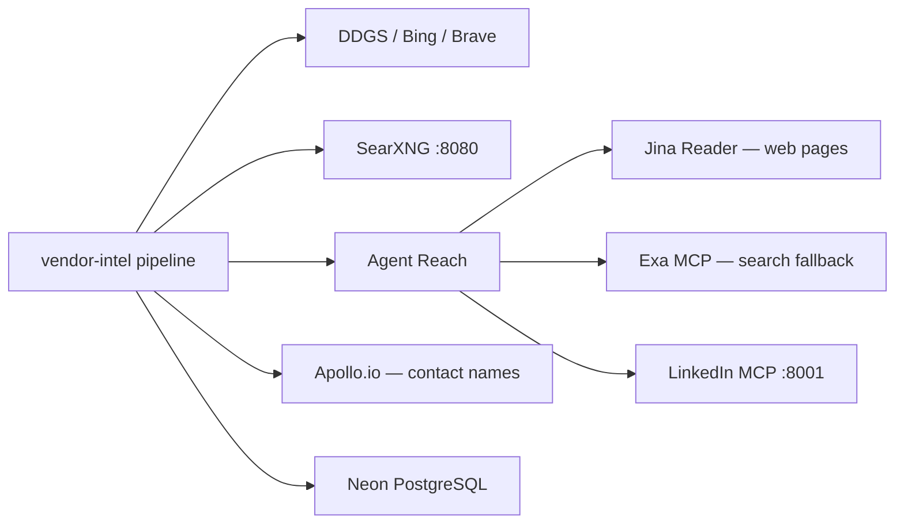

# Vendor Intel — Project Structure & Pipeline Overview

This document explains how the **vendor-intel** agent is organized, how data flows through the pipeline, and what each output file means.

**Project root:** `agents/vendor-intel/`

---

## Channel Partner Intelligence (default)

By default the pipeline runs in **channel-partner mode** (`CHANNEL_PARTNER_MODE=true`):

1. Infer dominant **channel types** for the market (e.g. MSSP/VAR for cyber; Converter/Fabricator for foam).
2. Discover and classify companies for those types — not a manufacturer census.
3. Export only verified channel partners (`role` / Excel **Business Type** = Channel Type).
4. Reject pure manufacturers (no channel role), brands-only, news, directories, gov, edu, associations.

Opt out for a full landscape run: `CHANNEL_PARTNER_MODE=false` or `discovery_mode=landscape` in query context.

**Excel columns are unchanged** (Company, Founded, Headquarters, Business Type, Contact Person, Key Brands Represented, …). Channel Type is written into the existing **Business Type** / `role` field.

Post-export enrichment is the same as before:

1. Gap-fill firmographics  
2. **LinkedIn MCP** fill/verify **Founded + Headquarters** (also cities/about/key brands when present)  
3. Apollo contact names  
4. Partial-name resolve  
5. Brand/domain identity + **Key Brands Represented** fill  
6. Market relevance audit → Excel → Neon  

Key module: `src/vendor_intel/funnel/channel_partner_types.py`

---

## 1. Top-level file structure

```
agents/vendor-intel/
│
├── run_query.py              ← Single-market CLI (interactive or --query)
├── run_batch.py              ← Multi-market batch (SQLite queue, resumable)
├── run_pipeline.py           ← Direct pipeline runner
├── apollo_contact_fill.py    ← Apollo contact search (also used in post-enrich)
├── export_founded_hq_v2.py   ← Founded+HQ Excel export
├── gap_fill_batch.py         ← Post-batch gap-fill across many markets
├── status_batch.py           ← Watch batch progress
│
├── .env / .env.example       ← API keys, toggles, output paths
├── docker-compose.yml        ← Local SearXNG stack
├── requirements.txt
│
├── config/
│   ├── default.yaml          ← Default pipeline settings
│   ├── export_columns.yaml   ← CSV column definitions
│   ├── export_schemas.yaml   ← FMCG (30 col) vs general (17 col) schemas
│   ├── tier1_markets.yaml    ← Known market profiles
│   ├── prompts/              ← LLM prompt templates
│   └── searxng/settings.yml  ← SearXNG engine config
│
├── queries/
│   ├── seeds/*.txt           ← Must-have company names per market
│   └── *.csv / *.txt         ← Batch input market lists
│
├── scripts/
│   ├── agent_reach_doctor.py ← Check Jina / Exa / LinkedIn MCP
│   ├── push_export_to_neon.py
│   └── push_all_exports_to_neon.py
│
├── data/
│   ├── batch.db              ← SQLite batch queue (WAL, resumable)
│   └── company_cache/        ← Cross-run website crawl cache
│
├── src/vendor_intel/         ← Main Python package (see §2)
├── tests/
├── ui/                       ← Streamlit UI helpers
└── output/                   ← Run artifacts (per-market folders)
```

---

## 2. `src/vendor_intel/` package map

| Folder | Role |
|--------|------|
| **`pipeline/`** | Core orchestration — discovery → enrich → classify → export → post_market |
| **`phase1/`** | Market understanding & query plan (LLM) |
| **`phase2/`** | Fast company discovery via search engines |
| **`enrichment/`** | Website crawl, gap-fill, Apollo, LinkedIn, audits |
| **`enrichment/gap_fill/`** | Post-export firmographic fill (Founded, HQ, contacts) |
| **`intelligence/`** | LLM company classifier & signal extraction |
| **`discovery/`** | Candidate pool, entity scoring, seed expansion |
| **`clients/`** | DDGS, Bing, SearXNG, Wikipedia, Wikidata SPARQL + rate limits |
| **`integrations/`** | Agent Reach (Jina/Exa), LinkedIn MCP, page fetch |
| **`batch/`** | SQLite queue, worker pool, batch orchestrator |
| **`export/`** | FMCG landscape Excel builder |
| **`neon_push.py`** | Push company rows to Neon PostgreSQL |
| **`config.py`** | `Settings` model loaded from env + YAML |

---

## 3. How the pipeline works (end-to-end)

### Entry points

| Command | Use case |
|---------|----------|
| `run_query.py` | One market at a time; auto post-enrich |
| `run_query.py --file queries.txt` | Sequential multi-market (no SQLite) |
| `run_batch.py --input markets.csv` | 100s–10,000s markets; resumable queue |

Both call **`execute_and_export()`** → **`run_pipeline()`** in `pipeline/orchestrator.py`.

### Main pipeline phases







| Step | What happens | Key module |
|------|--------------|------------|
| **1** | LLM builds market map, sections, search seeds | `phase1/runner.py` |
| **1b** | Resolve user seeds + enumerate known players | `pipeline/plan_seeds.py` |
| **2** | Search engines find company domains | `phase2/discovery_fast.py`, `clients/search_router.py` |
| **2b** | Optional multi-source discovery (B2B dirs, LinkedIn, Owler) | `pipeline/multi_source_discovery.py` |
| **3** | Crawl each company website (SSC / smart crawl) | `enrichment/smart_enrichment.py` |
| **4** | LLM classifies: relevant? role? confidence? | `intelligence/classifier.py` |
| **Filter** | Drop news sites, consultancies, duplicates | `pipeline/quality_export.py` |
| **Export** | Write CSV, JSON, DOCX, optional FMCG XLSX | `pipeline/orchestrator.py` |

### Post-enrich pipeline (8 steps)

Runs automatically after export when `--mode quality` or `--mode full` (unless `--no-post-enrich`).

| Step | Name | What it does |
|------|------|--------------|
| **1/8** | Gap-fill | Founded, HQ, LinkedIn URL, leadership from website + **Wikidata** + **LinkedIn MCP (fill missing + verify Founded/HQ)** + Owler + Crunchbase |
| **2/8** | LinkedIn verify | MCP re-check for rows still missing / unverified after gap-fill |
| **3/8** | Apollo names | Free Apollo search → `contact_person` (often partial, e.g. `Tim Co***k`) |
| **4/8** | Name resolve | Upgrade partial/missing names via leadership page → LinkedIn MCP → DDGS |
| **5/8** | Brand/domain fix | Correct wrong company identity (web + LinkedIn + OpenAI) |
| **6/8** | Market audit | Web search + LLM keep / review / remove |
| **7/8** | Excel export | `_founded_and_hq_v2.xlsx` + `_neon_filtered_export.json` |
| **8/8** | Neon push | Upsert companies to PostgreSQL (`DATABASE_URL`) |

**Resume:** Gap-fill checkpoints to `gap_fill_cache.json`. Re-run post-enrich only:

```powershell
cd C:\Users\aman.kumar\Desktop\Cmi\agents\vendor-intel
$env:PYTHONPATH = ".\src"
.\.venv\Scripts\python.exe -c "from pathlib import Path; from vendor_intel.pipeline.post_market import run_post_market_pipeline_sync; run_post_market_pipeline_sync(Path(r'C:\path\to\market_folder'))"
```

---

## 4. Pipeline modes

Set with `--mode bulk|standard|quality|full` on `run_query.py` or `run_batch.py`.

| Mode | Speed | Company cap | Post-enrich | Best for |
|------|-------|-------------|-------------|----------|
| **bulk** | Fastest (~5–12 min/market) | ~15–35 | Off | 10k+ markets on one PC |
| **standard** | Normal | ~50–90 | Off | CSV/JSON only |
| **quality** | Slower | ~50–90 | Full 8 steps | Production exports |
| **full** | Slowest | Broad | Full + deep enrich + audit | Maximum depth |

**Profiles:** `--profile quality` (default, strict export) vs `--profile recall` (more rows, noisier).

**Caps:** `--cap bulk|focused|standard|broad|maximum` overrides company limits.

> **Note:** `--mode full` forces **quality export** even if `--profile recall` is set. That is why a recall discovery run can still export only ~66 of 220 classified companies.

---

## 5. Integrations



| Integration | Env vars | Purpose |
|-------------|----------|---------|
| **Wikidata** | `WIKIDATA_ENABLED=true` (**no API key**) | Free SPARQL firmographics — founded, HQ, website, industry, parent |
| **Agent Reach** | `AGENT_REACH_ENABLED`, `AGENT_REACH_ROOT` | Jina page read, optional Exa search |
| **Exa** | `AGENT_REACH_EXA_SEARCH=true` | Semantic search when DDGS returns 0 |
| **LinkedIn MCP** | `AGENT_REACH_LINKEDIN_MCP=true` | Company profiles, employees, Founded/HQ verify |
| **LinkedIn delay** | `LINKEDIN_MCP_DELAY_SEC=4.0` | Rate limit between MCP calls |
| **SearXNG** | `SEARXNG_BASE_URL=http://127.0.0.1:8080` | Self-hosted meta-search fallback |
| **Apollo** | `APOLLO_API_KEY` | Contact person search (free tier, partial names) |
| **Neon** | `DATABASE_URL`, `PUSH_TO_NEON` | Push exports to shared DB |

**Doctor check:**

```powershell
cd agents/vendor-intel
.\.venv\Scripts\python.exe scripts\agent_reach_doctor.py
```

**LinkedIn MCP (keep running in a separate terminal):**

```powershell
.\.venv\Scripts\linkedin-scraper-mcp.exe --transport streamable-http --port 8001
mcporter.cmd config add linkedin http://localhost:8001/mcp
```

---

## 6. Output folder structure

### Single query (default: `output/demo/<slug>/`)

```
output/demo/global_smartwatch_market_global/
├── global_smartwatch_market_global.csv      ← Main export
├── global_smartwatch_market_global.json     ← Full data + _crawl metadata
├── global_smartwatch_market_global.docx     ← Word report
├── global_smartwatch_market_global.xlsx     ← FMCG landscape (if enabled)
├── global_smartwatch_market_global_founded_and_hq_v2.xlsx   ← Post-enrich Excel
├── _neon_filtered_export.json               ← Founded+HQ + audit passed → Neon
│
├── gap_fill_cache.json                      ← Gap-fill resume checkpoint
├── apollo_contact_cache.json                ← Apollo search cache
├── brand_resolve_cache.json
├── market_relevance_audit_cache.json
└── audit_report.md                          ← If batch audit enabled
```

### Batch (`output/<slug>/`)

Same layout per market under `output/<market_slug>/`.

### Session log (interactive runs)

```
output/demo/session_log.json
```

---

## 7. Data model (export row preview)

Each company in `relevant_companies[]` inside the JSON export:

```json
{
  "company": "Apple Inc.",
  "brand": "Apple",
  "domain": "apple.com",
  "website": "https://apple.com",
  "role": "Manufacturer",
  "role_description": "Consumer electronics and wearables",
  "is_relevant": true,
  "confidence": 0.92,
  "founded_year": "1976",
  "headquarters": "Cupertino, California, United States",
  "contact_person": "Tim Cook",
  "contact_role": "CEO",
  "linkedin": "https://www.linkedin.com/company/apple",
  "email": "",
  "_crawl": {
    "founded_year": "1976",
    "headquarters": "Cupertino, California, United States",
    "contact_person": "Tim Cook",
    "contact_role": "CEO",
    "linkedin": "https://www.linkedin.com/company/apple",
    "linkedin_verified": { "founded_year": true, "headquarters": true },
    "firmographic_source_linkedin_mcp": true
  }
}
```

| Field | Source (typical order) |
|-------|------------------------|
| `founded_year`, `headquarters` | Website crawl → gap-fill → LinkedIn MCP verify |
| `contact_person` | Leadership page → Apollo (partial) → LinkedIn MCP → DDGS search |
| `linkedin` (company) | Gap-fill LinkedIn source → LinkedIn MCP |
| `_crawl.linkedin_verified` | Set in post-enrich step 2 |

---

## 8. Batch vs single query

| | `run_query.py` | `run_batch.py` |
|--|----------------|----------------|
| **Markets per run** | 1 (or sequential file) | Many (parallel workers) |
| **Queue / resume** | Gap-fill cache only | SQLite `data/batch.db` |
| **Output dir** | `MARKET_QUERY_OUTPUT_DIR` (default `output/demo`) | `output/<slug>/` |
| **Monitor** | Terminal log | `status_batch.py --batch-id X --watch` |
| **10k markets** | Possible but manual | Recommended: `--mode bulk --yes` |

---

## 9. Essential environment variables

```env
# Core
USE_MOCK_DATA=false
LLM_PROVIDER=anthropic          # or opencode, openai, gemini, groq
ANTHROPIC_API_KEY=...

# Output
MARKET_QUERY_OUTPUT_DIR=output/demo

# Search
SEARXNG_BASE_URL=http://127.0.0.1:8080
PREFER_SEARXNG=true

# Agent Reach + LinkedIn
AGENT_REACH_ENABLED=true
AGENT_REACH_EXA_SEARCH=true
AGENT_REACH_LINKEDIN_MCP=true
LINKEDIN_MCP_DELAY_SEC=4.0
LINKEDIN_MCP_DELAY_JITTER=1.5

# Contacts
APOLLO_API_KEY=...
APOLLO_REQUEST_DELAY_SEC=2.0

# Neon
DATABASE_URL=postgresql://...
PUSH_TO_NEON=true
```

---

## 10. Quick command reference

```powershell
cd C:\Users\aman.kumar\Desktop\Cmi\agents\vendor-intel

# Interactive
.\.venv\Scripts\python.exe run_query.py

# Single market — full depth + post-enrich
.\.venv\Scripts\python.exe run_query.py --query "Global Smartwatch Market" --mode full --cap maximum --fmcg-xlsx --push-neon

# Fast bulk (no post-enrich)
.\.venv\Scripts\python.exe run_batch.py --input queries\markets.csv --batch-id mega-10k --mode bulk --yes

# Watch batch
.\.venv\Scripts\python.exe status_batch.py --batch-id mega-10k --watch

# Resume post-enrich only (after stop mid gap-fill)
$env:PYTHONPATH = ".\src"
.\.venv\Scripts\python.exe -c "from pathlib import Path; from vendor_intel.pipeline.post_market import run_post_market_pipeline_sync; run_post_market_pipeline_sync(Path(r'output\demo\your_market_folder'))"
```

---

## Related docs

- `docs/PIPELINE_AND_BATCH_ARCHITECTURE.md` — batch scaling, concurrency, worker design
- `../README.md` (agents/) — Neon setup, Agent Reach, LinkedIn MCP one-time install
